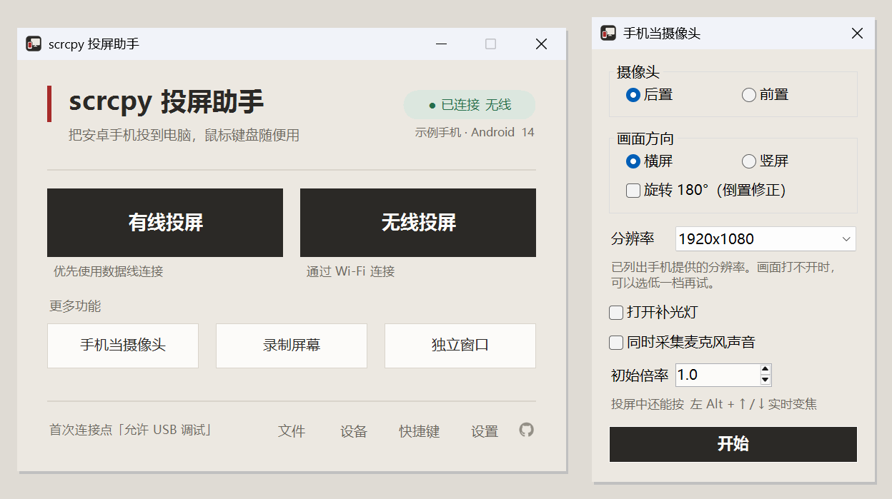
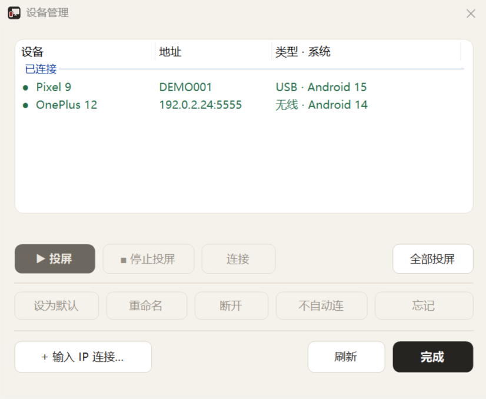
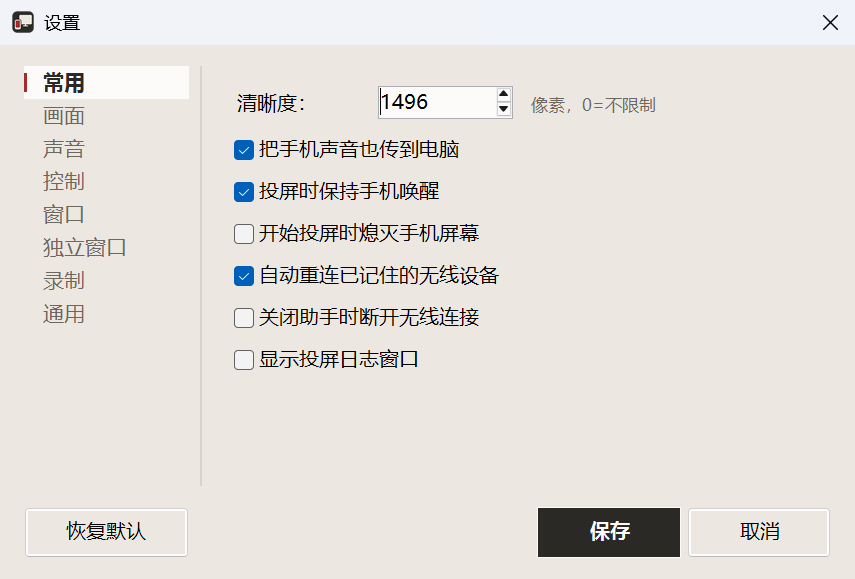

# scrcpy 投屏助手

> 不用背命令行参数，勾几个选项就把安卓手机投屏到电脑 —— 免安装，双击即用

 

**[⬇ 下载最新版](https://github.com/rockbenben/scrcpy-helper/releases/latest)** · Windows 10 / 11 · 已内置 scrcpy

[scrcpy](https://github.com/Genymobile/scrcpy) 是口碑最好的安卓投屏工具之一，但它只有命令行。本项目用一个单文件 PowerShell 脚本给它套了层图形界面：`--video-codec=h265` 这类参数，变成了窗口里的下拉和勾选。想要功能完整、跨平台，[QtScrcpy](https://github.com/barry-ran/QtScrcpy) 和 [escrcpy](https://github.com/viarotel-org/escrcpy) 更成熟；这里走的是另一条路——一个绿色便携的小工具，全中文，拷进 U 盘也能跑。

> [!TIP]
> 全程本地直连（数据线，或同一个 Wi-Fi），画面不经过任何服务器；手机端不 root、不装 App，只需在开发者选项里打开调试开关（USB 调试或无线调试）。

## 支持范围

| 项目 | 支持情况 |
| --- | --- |
| 电脑 | Windows 10 / 11，用系统自带 PowerShell；界面走 WinForms（Windows 自带 .NET Framework），无需另装运行库 |
| 安装 | 不需要，解压双击即可；卸载 = 删掉文件夹 |
| 手机 | Android 5.0 起可投屏、录屏；配对码无线连接与独立窗口需 11+，手机当摄像头需 12+ |
| 连接 | 数据线，或无线（同一局域网），可同时连多台 |
| 管理员权限 | 不需要，而且别用——会导致拖文件进投屏窗口失效 |

## 能做什么

- 🖥️ **设备中心 · 一键投屏**：顶部「当前设备」卡片显示已连上的手机（型号、系统版本、USB / Wi-Fi 标签），多台同时在线时点设备名就能切换；投屏、录屏或摄像头运行中会在卡片下方展开运行状态条，点「■ 停止」可直接结束。
  点击「开始投屏」立即投屏当前选中的手机；右侧「切到无线」（USB 设备时）或「无线连接…」支持插线转无线、配对码和输入 IP 连接。未连接时卡片内直接提供「用配对码连接」「输入 IP 连接」和「开启步骤 ?」。
  插线转无线成功后，拔线仍可在主界面或「设备管理」查看运行状态并点「停止」。若显示「无线连接失败」，先别拔线。确认手机已允许 USB 调试，并和电脑连着同一个 Wi-Fi。可点「查看原因」看详情。
- ⚡ **常用开关就地切换**：主界面提供「传声音」「投屏息屏」「窗口置顶」「清晰度」快捷胶囊，点一下立即生效并自动保存，与「设置」弹窗双向同步。
- 📷 **手机当摄像头**：在电脑窗口显示手机摄像头画面（Android 12+）。分辨率和变焦范围取决于手机镜头。支持后置/前置与横屏/竖屏分段切换、旋转 180°（手机倒置时修正），会记住倍率。系统打断摄像头时会尝试重连。供会议软件使用时，请用 OBS 捕获窗口并启动虚拟摄像头。
- 🎥 **录制屏幕**：可边投边录（遵循「投屏息屏」「窗口置顶」等设置），也可开启后台录制。可在「设置 > 录制」填好固定「保存目录」直接开录不弹窗；不填=每次弹窗选择并自动记住上次目录。录制中点主界面「停止录制」可只结束录制（不影响投屏窗口），也可在顶部「当前设备」卡片点「■ 停止」、托盘右键点「■ 停止录制」，或在「设备管理」选中设备后点「■ 停止投屏」。选 VP8 / VP9 编码，或开启音频并选原始 PCM 时，录屏使用 mkv。
- 🪟 **独立窗口**：在电脑上单开一块虚拟屏跑某个 App，手机照常用；首次使用默认选「竖屏·手机版面」并勾选「固定分辨率」。勾选时拖动窗口只改变电脑上的显示大小。取消勾选后，安卓虚拟屏会随电脑窗口改变大小，应用可能重新排版。也可选横屏·平板版面 / 跟随设置里的尺寸 / 自定义宽x高。
  点「更多应用」可从手机应用列表选取，「打开独立窗口」才会启动应用。要收藏或移除应用，点「管理常用」。
- 🗂️ **多设备**：连接与投屏分开，可同时投多台各开一窗。连过的设备自动记住。
  开启「不自动连」后，助手会跳过这台手机。已经配对的手机仍可能自己连上。要取消配对，请在手机的「无线调试」里忘记这台电脑。
- 📎 **拖拽即传**：普通文件拖进投屏窗口后默认传到手机的 Download，APK 会请求手机安装。安装或传输结果可在投屏日志窗口查看。
- ⚙️ **全中文，保存即记**：右上角可打开「快捷键」和「设置」，每个设置悬停都有大白话说明；清晰度、声音等设置，点「保存」后下次还能用。
- 📁 **文件管理**：主界面功能卡直达「文件管理」，具备浏览、上传、下载（自动记住上次保存文件夹）、重命名、新建文件夹、删除等基础功能，方便无线投屏时顺手管理文件。数据走 ADB 直连，手机端不用装 App、不用 root；接了多台手机时，窗口顶部可以切换设备。
  拒绝批内重名（含大小写冲突）、文件与文件夹同名，以及下载目录中的链接；请调整名称或保存位置后重试。
  关窗会取消设备探测和文件传输。下载时，已完成的文件会保留，尚未提交的覆盖保留原件。删除中断后，先点「刷新」确认哪些文件还在。
  覆盖授权仅适用于已确认的具体路径，新出现的同名目标会再次确认；可选择链接目录作为保存位置，实际写入路径中的链接和上传目标链接会被拦截。
  合并文件夹时，仅覆盖或跳过列出的冲突项，其余文件继续传输。覆盖后无法恢复。
- 🔔 **寻找手机**：手机在线时，点主窗口「当前设备」卡片里的铃铛图标（「寻找手机」），以最大闹钟音量循环播放手机当前的来电铃声，直到点「■ 停止」。手机须通过 USB 或无线 ADB 在线。多台在线时，先按设备名称、连接方式和序列号确认目标，再点「寻找这台」。停止响铃、断开连接或退出助手后，手机会恢复原来的闹钟音量。手机的勿扰规则可能限制闹钟发声。

| 设备管理：多设备切换 / 同时多投 | 设置：左侧分类，保存后记住 |
| :---: | :---: |
|  |  |

## 快速开始

1. 下载 [Releases](https://github.com/rockbenben/scrcpy-helper/releases/latest) 里的 zip，解压到任意文件夹。
2. 手机开启「USB 调试」：设置 > 关于手机 > 连点 7 次版本号，返回设置进「开发者选项」打开。
3. 双击 `投屏助手-双击运行.bat`，用支持数据传输的 USB 线连接手机，点「开始投屏」。

首次连接时手机上会弹「允许 USB 调试」，点允许就好。逐项说明见随包的 `使用说明.txt`，也可看[图文教程](https://newzone.top/posts/2019-08-26-scrcpy_screen_projection.html)。

在「设置 > 通用」的「其它命令行参数」中，参数之间用空格分隔。含空格的值用双引号包住，例如 `--window-title="Living Room"`。

## 已知限制

- **以管理员身份运行时，拖文件进投屏窗口会显示禁止图标。** Windows 不允许普通权限的资源管理器向管理员权限的窗口拖放（UIPI 隔离）。助手本就无需管理员，正常双击 `.bat` 即恢复。
- **键鼠控制**。投屏时用默认键鼠模式即可。中文可用 `Ctrl+V` 粘贴，也可选「模拟实体键盘」，用手机输入法打字。
- **应用双开 / 分身在独立窗口里黑屏。** 分身跑在另一个安卓用户身份下，且部分应用拒绝在虚拟屏渲染，scrcpy 无法定向过去；改用普通投屏在手机上开分身即可。
- **声音**。把手机声音传到电脑需要 Android 11 或以上。Android 11 请先解锁手机再投屏。
- **画面卡顿或花屏**。无线投屏卡顿时，先调低「清晰度」或「画质」。画面花屏、偏色时，在「设置 > 画面」选「软件解码」再试。
- **投屏启动失败**。若提示「无法启动投屏」，点「查看原因」看详情。若提示「投屏窗口没能打开」，可在「设置 > 常用」勾选「显示投屏日志窗口」并保存，再投一次看报错。
- **控制模式限制**：开启「只投屏，不允许控制手机」时，独立窗口不可用。可以用「开始投屏」只看画面。只看模式下，保持唤醒、投屏关屏、显示触摸点和关窗息屏暂不生效。
- **配置保存要求**：设置无法保存时会提示「保存设置失败」，本次修改仅在当前运行中生效。请确认软件目录可写。
  加载时，单个无效设置使用默认值，其余有效设置和设备记忆照常恢复。整份设置文件无法读取时，下次保存会在软件目录保留一份原文件备份（`.bak`）。
- **后台状态与重连**：设备状态刷新和已记住设备重连在后台进行。打开主窗口时「当前设备」显示「正在检测手机…」，第一次查询失败后会在后台再试一次。显示「连接状态待确认」时，暂时无法确认手机连接状态，切回窗口会重试。忙碌期间的刷新请求会合并，空闲后补查。自动重连成功后，主窗口立即更新连接状态。关闭「设备管理」后，主窗口会刷新连接状态。没有在线设备时，「等待手机授权」提示解锁手机并点「允许 USB 调试」，「手机离线」提示重新插拔数据线，或检查 Wi-Fi 后重新连接。若重试仍失败，可打开「设备管理」，点「查看原因」。「设备管理」刷新失败时会显示『连接状态待确认，请点击「刷新」重试。』原列表保留，依赖连接状态的操作要等刷新成功后才能使用。
- **处理等待与取消**。等待框会显示当前步骤，例如「正在读取设备列表…」「正在配对并连接手机…」。点「取消」可结束本次等待，已经完成的配对、连接或停止操作会保留。文件管理读取目录时显示「正在读取…」，关窗会停止读取，读取超时或失败时显示「（打不开这个目录）」。
- **停止录屏与退出保护**：录屏停止超时后，可选「继续等待」「强制结束」或「取消」。强制结束可能导致视频文件损坏或无法播放。强制结束后会提示「已强制结束录屏，请检查视频文件。」；异常退出会提示「录屏异常结束，请检查视频文件。」
- **独立窗口大小**。一般用预设就可以。字太大时，到「设置 > 独立窗口」把「界面缩放」选为「小」。
- **无线配对与 IP 直连**。Android 11+ 用配对码时，从手机配对弹窗抄「IP 地址和端口」和 6 位配对码。配对后助手会尝试自动连接。若提示「请手动填写连接端口」，从「无线调试」主界面取端口。手动「输入 IP 连接」也用这个连接端口。插数据线切到无线时通常用 5555。
- **关闭助手收尾**：关闭助手会先尝试正常停止助手启动的投屏和录屏；勾选「关闭助手时断开无线连接」时，定向断开助手记住或启动过的无线设备。
  若提示「无线连接未全部断开」，可查看「断开失败」和「尚未处理」的设备，再选「仍然退出」或「取消」。

## 许可证

本仓库的三个文件（`scrcpy-helper.ps1`、`投屏助手-双击运行.bat`、`使用说明.txt`）以 [MIT](./LICENSE) 开源。

发行包里除此之外的一切都来自 Genymobile 的 [scrcpy](https://github.com/Genymobile/scrcpy) 官方 win64 发行包，**原样转发、未作修改**，遵循其 Apache-2.0 许可，随包的 `LICENSE.txt` 即该许可全文。逐项清单见 [THIRD-PARTY-NOTICES.md](./THIRD-PARTY-NOTICES.md)。

想自己打包发行版、或帮忙做界面多语言，见 [CONTRIBUTING.md](./CONTRIBUTING.md)。

## 关于 365 开源计划

[365 开源计划](https://github.com/rockbenben/365opensource) 的第 **#019** 个项目——一个人 + AI，一年 300+ 个开源项目。

[提交你的需求 →](https://365.aishort.top/) · [Discord](https://discord.gg/PZTQfJ4GjX) · [Telegram](https://t.me/aishort_top)
