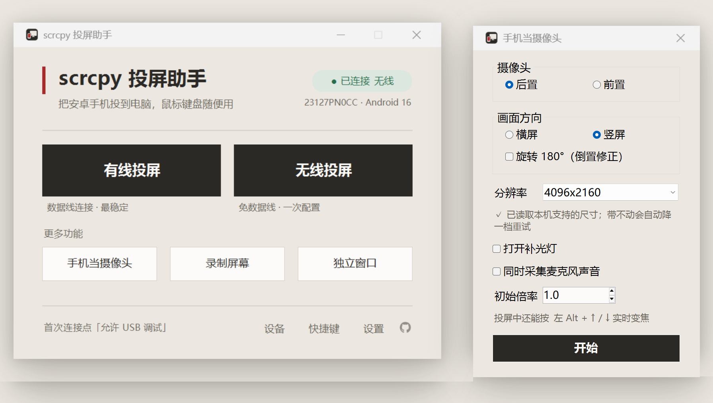
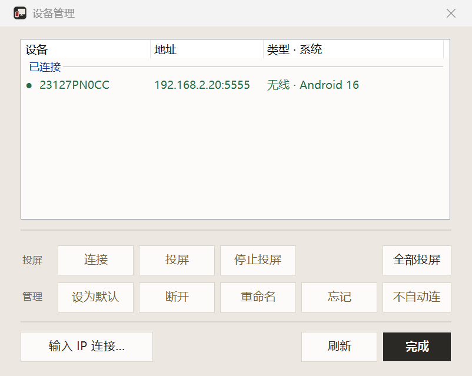
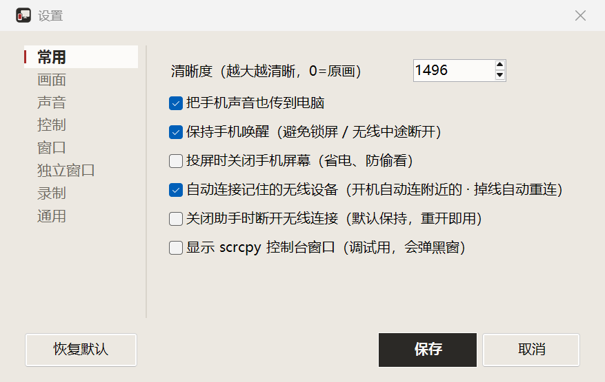

# scrcpy 投屏助手

> 不用背命令行参数，勾几个选项就把安卓手机投屏到电脑 —— 免安装，双击即用

 

**[⬇ 下载最新版](https://github.com/rockbenben/scrcpy-helper/releases/latest)** · Windows 10 / 11 · 已内置 scrcpy

[scrcpy](https://github.com/Genymobile/scrcpy) 是口碑最好的安卓投屏工具之一，但它只有命令行。本项目用一个单文件 PowerShell 脚本给它套了层图形界面：`--video-codec=h265` 这类参数，变成了窗口里的下拉和勾选。想要功能完整、跨平台，[QtScrcpy](https://github.com/barry-ran/QtScrcpy) 和 [escrcpy](https://github.com/viarotel-org/escrcpy) 更成熟；这里走的是另一条路——一个绿色便携的小工具，全中文，拷进 U 盘也能跑。

> [!TIP]
> 全程本地直连（数据线，或同一个 Wi-Fi），画面不经过任何服务器；手机端不 root、不装 App，只需在开发者选项里打开调试开关（USB 调试或无线调试）。

## 支持范围

| 项目 | 支持情况 |
| --- | --- |
| 电脑 | Windows 10 / 11，用系统自带 PowerShell；界面走 WinForms（Windows 自带 .NET Framework），无需另装运行库 |
| 安装 | 不需要，解压双击即可；卸载 = 删掉文件夹 |
| 手机 | Android 5.0 起可投屏、录屏；配对码无线连接与独立窗口需 11+，手机当摄像头需 12+ |
| 连接 | 数据线，或无线（同一局域网），可同时连多台 |
| 管理员权限 | 不需要，而且别用——会导致拖文件进投屏窗口失效 |

## 能做什么

- 🖥️ **有线 / 无线投屏**：无线有三种走法——插一次线自动切换（之后可拔线）、Android 11+ 用配对码全程免插线、或直接填 IP 保底。
- 📷 **手机当摄像头**：分辨率按镜头报告的支持列表给；同一朝向只使用第一颗镜头的尺寸与变焦范围。支持横屏、竖屏和「旋转 180°（倒置修正）」，手机倒置也能摆正画面；可变焦到超广角或长焦，倍率会记住；手机亮屏被系统抢走摄像头时自动重连。
- 🎥 **录制屏幕**：边投边录，存 mp4 / mkv，文件名带时间戳不会覆盖上一次。选 VP8 / VP9 编码，或开启音频并选原始 PCM 时，录屏使用 mkv。
- 🪟 **独立窗口**：在电脑上单开一块虚拟屏跑某个 App，手机照常用；可选竖屏·手机版面 / 横屏·平板版面 / 跟随设置里的尺寸 / 自定义宽x高。
- 🗂️ **多设备**：连接与投屏分开，可同时投多台各开一窗；连过的设备自动记住，断线后点任意功能会先自动连回。
- 📎 **拖拽即传**：文件拖进投屏窗口就传到手机，拖 APK 进去直接安装。
- ⚙️ **全中文，保存即记**：每个设置悬停都有大白话说明；清晰度、编码、声音等选择点「保存」后记住，下次沿用。
- 📁 **文件管理**：具备浏览、上传、下载、重命名、新建文件夹、删除等基础功能，方便无线投屏时顺手管理文件。数据走 ADB 直连，手机端不用装 App、不用 root；接了多台手机时，窗口顶部可以切换设备。
  拒绝批内重名（含大小写冲突）、文件与文件夹同名，以及下载目录中的链接；请调整名称或保存位置后重试。
  设备探测和下载合并支持关窗取消；下载暂存在所选目录，取消时已完成的文件会保留，正在替换的文件保留原件。
  覆盖授权仅适用于已确认的具体路径，新出现的同名目标会再次确认；可选择链接目录作为保存位置，实际写入路径中的链接和上传目标链接会被拦截。
  合并文件夹时，仅跳过确认框列出的冲突子项，其余文件继续保存；链接检查仅覆盖本次实际写入的路径。

| 设备管理：多设备切换 / 同时多投 | 设置：左侧分类，保存后记住 |
| :---: | :---: |
|  |  |

## 快速开始

1. 下载 [Releases](https://github.com/rockbenben/scrcpy-helper/releases/latest) 里的 zip，解压到任意文件夹。
2. 手机开启「USB 调试」：设置 > 关于手机 > 连点 7 次版本号，返回设置进「开发者选项」打开。
3. 双击 `投屏助手-双击运行.bat`，插上数据线，点「有线投屏」。

首次连接时手机上会弹「允许 USB 调试」，点允许就好。逐项说明见随包的 `使用说明.txt`，也可看[图文教程](https://newzone.top/posts/2019-08-26-scrcpy_screen_projection.html)。

## 已知限制

- **以管理员身份运行时，拖文件进投屏窗口会显示禁止图标。** Windows 不允许普通权限的资源管理器向管理员权限的窗口拖放（UIPI 隔离）。助手本就无需管理员，正常双击 `.bat` 即恢复。
- **电脑输入法的中文打不进投屏窗口**（只能 `Ctrl+V` 粘贴）。这是 scrcpy + Windows 输入法的固有限制，组词阶段的字捕获不到。彻底解决可给手机装 [ADBKeyboard](https://github.com/senzhk/ADBKeyBoard)，或键盘模式选「游戏模式」用手机自带输入法。
- **应用双开 / 分身在独立窗口里黑屏。** 分身跑在另一个安卓用户身份下，且部分应用拒绝在虚拟屏渲染，scrcpy 无法定向过去；改用普通投屏在手机上开分身即可。
- **控制模式限制**：「只投屏，不允许控制手机」开启时，保持唤醒、投屏关屏、显示触摸点和关窗息屏暂不生效。
- **配置保存要求**：设置无法保存时会提示「保存设置失败」，本次修改仅在当前运行中生效。请确认软件目录可写。
- **后台状态与重连**：设备状态刷新和已记住设备重连在后台进行。查询失败时显示「○ 状态查询失败」，点击功能时提示「查询设备失败，请稍后重试」。点「文件」进入文件管理也走同一条设备查询。
- **处理等待与取消**：摄像头能力读取、无线配对和设备管理等待时显示「正在处理，请稍候…」，可点「取消」结束本次等待。已经完成的配对、连接或停止操作仍会保留。操作超时后可重试。文件管理的目录读取也在后台进行，等待时列表下方显示「正在读取…」；关掉窗口即取消本次读取，超时或没读到完整目录时显示「（打不开这个目录）」，不会当成「这个文件夹是空的」。
- **停止录屏与退出保护**：录屏停止超时后，可选「继续等待」「强制结束」或「取消」。强制结束可能导致视频文件损坏或无法播放。强制结束后会提示「已强制结束录屏，请检查视频文件。」；异常退出会提示「录屏异常结束，请检查视频文件。」
- **独立窗口自定义尺寸**：独立窗口自定义尺寸中，不填宽高=跟手机一致，不填 DPI=默认；只改 DPI 也会生效。已保存的自定义 DPI 会保留在选项中。
- **无线调试 mDNS 支持**：无线调试自动发现的 mDNS 设备也会按无线设备处理，可直接投屏。
- **关闭助手收尾**：关闭助手会先尝试正常停止助手启动的投屏和录屏；勾选「关闭助手时断开无线连接」时，定向断开助手记住或启动过的无线设备。

## 许可证

本仓库的三个文件（`scrcpy-helper.ps1`、`投屏助手-双击运行.bat`、`使用说明.txt`）以 [MIT](./LICENSE) 开源。

发行包里除此之外的一切都来自 Genymobile 的 [scrcpy](https://github.com/Genymobile/scrcpy) 官方 win64 发行包，**原样转发、未作修改**，遵循其 Apache-2.0 许可，随包的 `LICENSE.txt` 即该许可全文。逐项清单见 [THIRD-PARTY-NOTICES.md](./THIRD-PARTY-NOTICES.md)。

想自己打包发行版、或帮忙做界面多语言，见 [CONTRIBUTING.md](./CONTRIBUTING.md)。

## 关于 365 开源计划

[365 开源计划](https://github.com/rockbenben/365opensource) 的第 **#019** 个项目——一个人 + AI，一年 300+ 个开源项目。

[提交你的需求 →](https://365.aishort.top/) · [Discord](https://discord.gg/PZTQfJ4GjX) · [Telegram](https://t.me/aishort_top)
